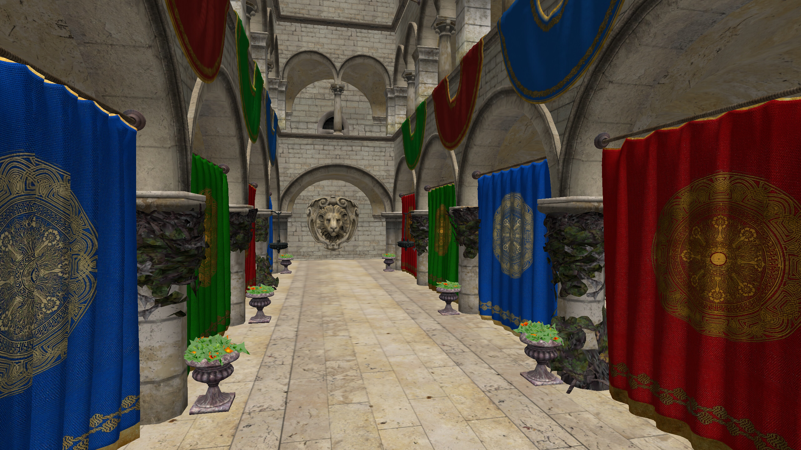
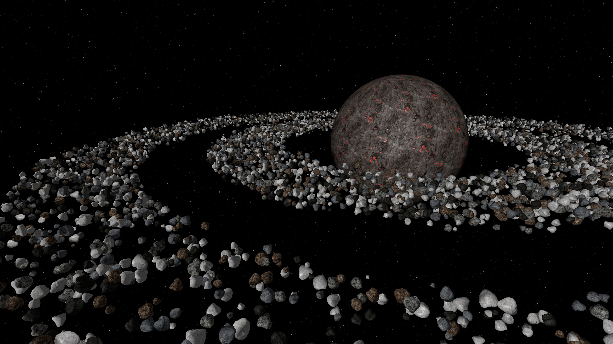
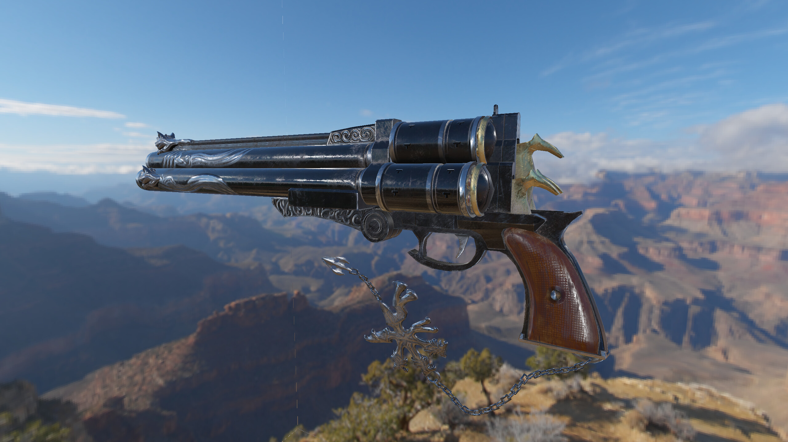
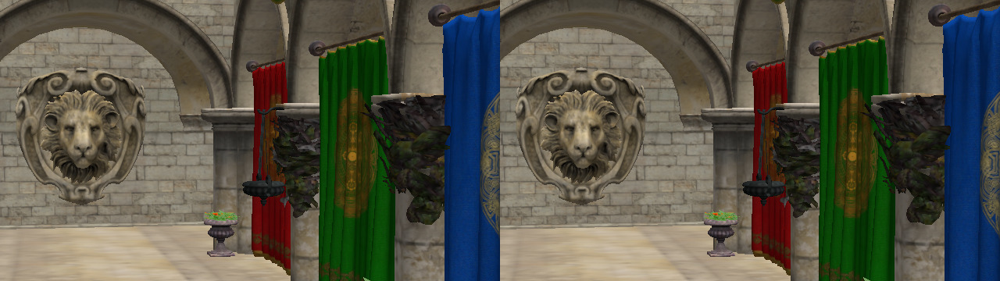
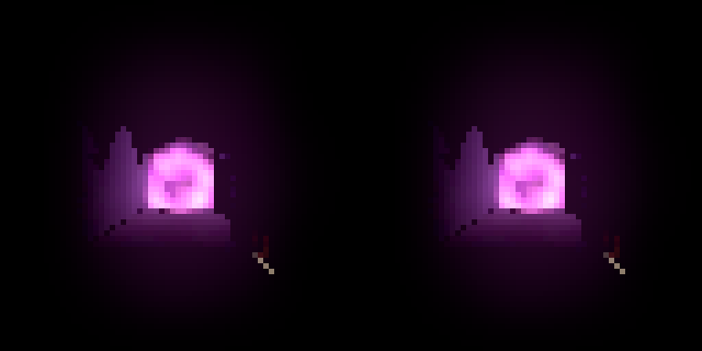

<h1 align="center">CRISP Artifact — Vulkan-Sim 2.0</h1>

<p align="center">
  <b>Cycle-level GPU simulation of real Vulkan rendering, verified pixel-for-pixel against Mesa's software renderer.</b><br/>
  <a href="https://github.com/JRPan/vulkan-sim/tree/dev-2.0"></a>
  <a href="https://github.com/JRPan/mesa-vulkan-sim/tree/dev-2.0"></a>
  
  
  
</p>

> **This branch (`2.0`) tracks ongoing work to port CRISP onto Vulkan-Sim 2.0.**
> For the exact code used in the paper, see the [`main`](https://github.com/JRPan/crisp-artifact/tree/main) branch (aging, minimal support) or the pinned Zenodo release. If you need the original artifact and can't reproduce from `main`, please open an issue and I can help.

## Gallery: rendered by Vulkan-Sim

Every frame below is the output of vulkan-sim's simulated vertex and pixel shaders. Each draw was checked against
llvmpipe (Mesa's CPU Vulkan renderer) rendering the same draw.

<table>
  <tr>
    <td align="center" width="50%">
      <br/>
      <b>① Sponza</b> — Vulkan-Samples <code>render_passes</code><br/>
      2560×1440 · 25 draws · <b>100% bit-exact</b> on every draw
    </td>
    <td align="center" width="50%">
      <br/>
      <b>② Asteroid field</b> — Vulkan-Samples <code>instancing</code><br/>
      2560×1440 · 4,096 instanced rocks + planet + starfield · <b>100% bit-exact</b><br/>
      1.68 M vertex-shader invocations, all outputs 0 ULP
    </td>
  </tr>
  <tr>
    <td align="center">
      <br/>
      <b>③ Textured PBR</b> — Sascha Willems <code>pbrtexture</code><br/>
      2560×1440 · cube-map skybox + PBR model with IBL<br/>
      99.997% bit-exact, max diff 37 LSB on 0.003% of pixels (llvmpipe cube-seam artifact ⁽¹⁾)
    </td>
    <td align="center">
      <br/>
      <b>④ Side by side</b> — Sponza crop at native resolution<br/>
      left: llvmpipe (golden) · right: vulkan-sim · identical bytes<br/><br/>
      <br/>
      <b>⑤ Godot 4 engine</b> — <code>sponza</code> export, frame 10, final composite pass (64×64, upscaled)<br/>
      left: llvmpipe · right: vulkan-sim · alpha-blended, bit-exact
    </td>
  </tr>
</table>

<sub>⁽¹⁾ llvmpipe shades two 2×2 quads per 8-wide SIMD vector, and its cube-map path lets the second quad depend on the
first. That produces faint seams in llvmpipe's <i>own</i> image (the thin vertical line in ③ is in the golden image too).
vulkan-sim samples each quad independently, as hardware does, so those few pixels differ by design.</sub>

## What renders today

| Workload | Source | Result vs llvmpipe |
|---|---|---|
| `render_passes` (Sponza) | Vulkan-Samples | ✅ bit-exact, all 25 draws at 2560×1440 |
| `instancing` | Vulkan-Samples | ✅ bit-exact at 2560×1440, 4,096 instances (first frame) |
| `texture_mipmap_generation` | Vulkan-Samples | ✅ bit-exact (trilinear, mipmaps) |
| `dynamic_uniform_buffers` | Vulkan-Samples | ✅ bit-exact |
| `hlsl_shaders` | Vulkan-Samples | ✅ bit-exact |
| `hello_triangle`, `separate_image_sampler` | Vulkan-Samples | ✅ bit-exact |
| `texture_loading` | Vulkan-Samples | 🟡 99.81%: llvmpipe quad-coupling with a per-fragment LoD bias ⁽¹⁾ |
| `pbrtexture` | Sascha Willems | 🟡 99.997%: cube-seam artifact ⁽¹⁾; render-to-texture precompute runs on llvmpipe |
| Godot 4 `sponza`, `demo`, `material`, `platformer` | Godot exports | 🟡 final composite pass bit-exact; 3D scene passes are render-to-texture (not yet simulated) |
| `hdr` | Vulkan-Samples | ❌ needs float render targets |

**What is simulated:**
- **Shaders:** vertex and pixel shaders, compiled NIR → PTX by a native C emitter (`nir_to_ptx.c`).
- **Rasterization:** llvmpipe's own, with whole 2×2 quads and helper lanes.
- **Texture sampling:** llvmpipe's JIT'd sampler, so filtering, LoD, mip selection and wrap modes match. The texel
  addresses it chooses drive vulkan-sim's texture-cache timing.
- **Blending:** llvmpipe's blend stage, functional only (no ROP timing yet). Includes color masks and logic ops.
- **Draw state:** depth test, sRGB/UNORM targets and instancing.

**Not yet:**
- render-to-texture of a different size than the swapchain (skipped with `GPGPUSIM_SKIP_RTT=1`);
- float or multiple render targets;
- `discard` combined with depth writes;
- ROP/blend timing;
- moving the ray-tracing shader path off the legacy Python lowering.

### How correctness is checked

`GPGPUSIM_VERIFY=1` runs every draw twice in one pass:
1. **Golden:** llvmpipe renders the draw as usual.
2. **Simulated:** vulkan-sim renders the same draw from the same pre-draw framebuffer and depth.
3. **Compare:** the two are compared in the stored format. The run writes `verify.csv` (exact %, max LSB, PSNR,
   coverage, depth) and `verify_vs.csv` (vertex-shader outputs, in ULP), plus golden / sim / diff images per draw.

With `GPGPUSIM_FRAG_FEED=1`, llvmpipe's rasterized fragments feed vulkan-sim's pixel shader. The vertex shader and
pixel shader are then each checked on exact inputs.

---

# Artifacts for CRISP: Concurrent Rendering and Compute Simulation Platform for GPUs

### Repository layout

- `accel-sim-framework/` — the simulator (checked in, unchanged).
- `vulkan-sim/` — **git submodule**, tracks `dev-2.0` of [JRPan/vulkan-sim](https://github.com/JRPan/vulkan-sim/tree/dev-2.0).
- `mesa-vulkan-sim/` — **git submodule**, tracks `dev-2.0` of [JRPan/mesa-vulkan-sim](https://github.com/JRPan/mesa-vulkan-sim/tree/dev-2.0).
- `embree-3.13.5.x86_64.linux/` — Embree binary distribution.
- `gpgpusim.config`, `config_turing_islip.icnt` — simulator configs.
- `container/` — Ubuntu 24.04 Dockerfile / Apptainer recipe (shared `packages.txt`).
- `docs/images/` — the gallery above.

### Building (Ubuntu 24.04 container)

Everything builds and runs inside an Ubuntu 24.04 image. The package list is `container/packages.txt`, and the Docker
and Apptainer recipes both read it. You also need CUDA 11.x on the host, for `ptxas`.

```bash
$ git clone --recurse-submodules -b 2.0 https://github.com/JRPan/crisp-artifact.git && cd crisp-artifact
$ git submodule update --remote          # optional: move to the newest dev-2.0 commits

# Docker
$ docker build -t vulkan-sim-2404 container/
$ docker run -it --rm -v $PWD:$PWD -w $PWD vulkan-sim-2404 bash
# ...or Apptainer
$ apptainer build --fakeroot vulkan-sim-2404.sif container/vulkan-sim-2404.def
$ apptainer shell --bind $PWD vulkan-sim-2404.sif
```

Inside the container:

```bash
$ export CUDA_INSTALL_PATH=/path/to/cuda-11.7
$ source embree-3.13.5.x86_64.linux/embree-vars.sh
$ source vulkan-sim/setup_environment debug          # or: release
# Mesa and vulkan-sim link against each other: configure Mesa, build vulkan-sim, then install Mesa
$ meson setup mesa-vulkan-sim/build mesa-vulkan-sim --prefix=$PWD/mesa-vulkan-sim/lib \
      -Dbuildtype=debug -Db_lundef=false -Dvulkan-drivers=swrast -Dgallium-drivers=swrast -Dplatforms=x11
$ ninja -C mesa-vulkan-sim/build install   # the first pass may fail to link; that's expected
$ make -C vulkan-sim -j$(nproc)
$ ninja -C mesa-vulkan-sim/build install
$ export VK_ICD_FILENAMES=$PWD/mesa-vulkan-sim/lib/share/vulkan/icd.d/lvp_icd.x86_64.json
```

### Building Accel-Sim (trace-driven experiments)

```bash
$ docker run -it --rm -v $(pwd)/accel-sim-framework:/accel-sim/accel-sim-framework tgrogers/accel-sim_regress:Ubuntu-22.04-cuda-11.7
$ cd accel-sim-framework
$ source gpu_simulator/setup_environment
$ make -j -C ./gpu-simulator
$ exit
```

### Running

Run apps from a directory that contains `gpgpusim.config` and `config_turing_islip.icnt` (both are in this repo).
Apps need an X display. For a headless run use `xvfb-run`, with the screen size matching the app's resolution.

```bash
$ GPGPUSIM_VERIFY=1 GPGPUSIM_FRAG_FEED=1 GPGPUSIM_EXIT_AFTER_PRESENTS=1 \
  xvfb-run -a -s "-screen 0 640x360x24" vulkan_samples sample render_passes --width 640 --height 360
```

| Variable | Effect |
|---|---|
| `GPGPUSIM_VERIFY=1` | Per-draw comparison against llvmpipe (`verify.csv`, `verify_vs.csv`, PPM images) |
| `GPGPUSIM_FRAG_FEED=1` | Use llvmpipe's rasterized quads, sampler and blend stage (requires `VERIFY`) |
| `GPGPUSIM_SKIP_RTT=1` | Simulate only draws that target the swapchain |
| `GPGPUSIM_MAX_DRAWS=N` / `GPGPUSIM_SKIP_DRAWS=N` | Simulate a window of draws |
| `GPGPUSIM_MAX_INSTANCES=N` | Cap instance counts (applies to both renderers, so the comparison stays exact) |
| `GPGPUSIM_START_PRESENT=N` | Leave the first N frames (loading screens, splash) to llvmpipe |
| `GPGPUSIM_EXIT_AFTER_PRESENTS=N` | Exit after N presents (default 2) |
| `GPGPUSIM_LEGACY_PTX=1` | Use the old `nir_print` + Python NIR→PTX path |

### Experiment workflow (paper reproduction)

The scripts below reproduce the paper experiments using the traces from the original artifact. Trace collection with 2.0 is still being validated across all paper workloads.

```bash
$ docker run -it --rm -v $(pwd)/accel-sim-framework:/accel-sim/accel-sim-framework tgrogers/accel-sim_regress:Ubuntu-22.04-cuda-11.7
$ cd accel-sim-framework
$ . get_crisp_traces.sh
$ cd util/graphics
$ python3 ./setup_concurrent.py
$ cd ../../
$ . run.sh
```

Monitor with `./util/job_launching/job_status.py`. Expect ~8 hours. Results land in `sim_run_11.7`.

Collect stats and exit the container:

```bash
$ . collect.sh
$ exit
```

### Collecting your own traces

From the Vulkan-Samples folder:

```bash
$ VULKAN_APP=render_passes ./build/linux/app/bin/Release/x86_64/vulkan_samples sample render_passes
```

Resolution is set to 480P for speed. Once `complete.traceg` is produced, from `accel-sim-framework/util/graphics/`, edit line 7 to point at the trace and (optionally) line 4 to set the output folder, then:

```bash
$ python3 ./process-vulkan-traces.py
```

### Evaluation

The scripts below reproduce paper figures from the collected CSVs (`render_passes_2k.csv`, `render_passes_2k_lod0.csv`).

L1 texture plot (Figure "L1 TEX Loads"):

```bash
$ python3 ./util/graphics/l1tex.py
```

L2 breakdown (Figure "L2 breakdown") — update `l2breakdown.py::7` to match the visualizer log under `sim_run*`:

```bash
$ python3 ./util/graphics/l2breakdown.py
```

Slicer occupancy (Figure "slicer occupancy") — update `concurrent_ratio.py::7` to `sim_run_11.7/render_passes_2k/all1/RTX3070-SASS-concurrent-fg-VISUAL`:

```bash
$ python3 ./util/graphics/concurrent_ratio.py
```

Static TEX working-set analysis (Figure "TEX working set") is in `util/graphics/working_set.ipynb`.

### Want the original paper artifact?

The exact snapshot used for the CRISP paper lives on the [`main`](https://github.com/JRPan/crisp-artifact/tree/main) branch and on [Zenodo](https://zenodo.org/records/12803388). Both are aging and largely unsupported — if you need help getting that version running, please open an issue and I'll do what I can.
